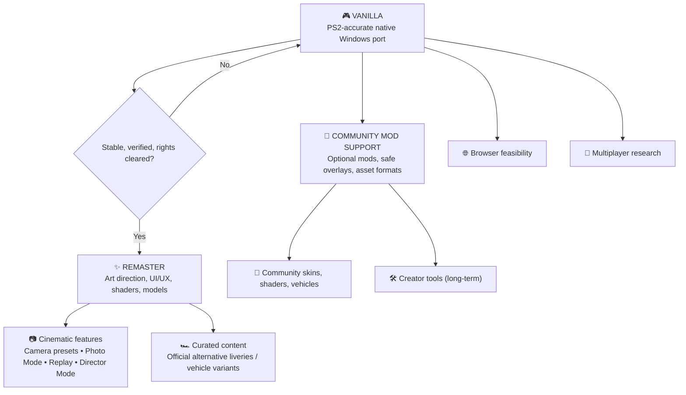

# 🏁 Speed Racer Native Port — Development Roadmap

[Overview](README.md) · [Open issues](../../issues) · [UI/UX concept brief](docs/REMASTER_UI_UX.md)

> **Vision:** Preserve the original PS2 game through a faithful native PC port (**Vanilla**). Then create a thoughtfully redesigned, improved **Remaster**. Community **Mods** remain separate, optional extensions. Online and browser support are longer-term research directions. No release dates are promised.

## 🗺️ At a glance

These are conceptual branches; feature feasibility and distribution permissions must be assessed separately.

## Product identity and boundaries

| Edition / track | Purpose | Included examples | Priority |
| --- | --- | --- | --- |
| **Vanilla** | Faithful preservation | Original UI, camera, assets, physics, timing, graphics, sound, input and saves | 🔄 **Now** |
| **Remaster Core** | A curated, polished modern edition | Complete UI/UX redesign, refined shaders/materials, lighting/VFX, optimized and refined 3D models, HD rendering | ⏳ **After Vanilla** |
| **Remaster Features** | First-party experience improvements | F1-style configurable cameras, Photo Mode, improved replay, Director Mode, optional Ghost Racing | 💡 Future |
| **Remaster Content** | First-party curated additions | Optional alternative skins/liveries; e.g. red heritage variant or black/yellow Racer X-inspired Match 6 concept | 💡 Future |
| **Community Mods** | Optional third-party contributions | Reversible livery/skin packs, shader/texture mods, custom models, optional creator tools | 🔬 Future |
| **Multiplayer / Web** | Independent platform and netcode R&D | Online races, browser build feasibility | 🔬 Research |

**Rule:** The same category of asset can belong to Remaster *or* Mods. Classification depends on integration and curation: first-party variants shipped as part of an authorized Remaster are **Remaster content**; optional user-installed community packs are **Mods**. The Vanilla baseline stays unchanged.

## Phase 0 — Windows proof of concept (local validation)

- [x] Windows GUI executable launches without a console window
- [x] Controller integration implemented; maintainer confirmed a physical controller
- [x] Local source/runtime inventory and measured build environment documented
- [ ] Independent reproduction and complete dependency/provenance review

## Phase 1 — Vanilla stabilization (CURRENT)

Updated **2026-10-21**. Current private playable build: [v25](docs/audit/vanilla-v25.md). [V27](docs/audit/vanilla-v27.md) now integrates the hardware GS and supplies a separate private experimental GUI package, initially 3x. It has not replaced the v25 baseline or passed full-race/FPS promotion. Preserved throughput reference: v17 at 1x. Fullscreen now fills the monitor, and internal resolution is selectable from 1x to 4x, with 2x as the GUI default. Higher scales lose substantial FPS in Fuji; this is a quality option, not a fluency milestone.

| Milestone | Current evidence | Next completion criterion |
|---|---|---|
| Reproducible native build | v23 coverage repaired/guarded; v24 clean build; v25 retains 332 generated inputs and 310 extra VU symbols | Keep manifests and complete native coverage in every candidate |
| Modern display controls | Fullscreen adaptation and 1x–4x selection implemented; 39 tests and four real-resolution captures pass | Accept native selector/shortcut interaction and monitor changes; arbitrary ultrawide camera remains separate |
| Efficient graphics at higher resolution — P0 | [V27 runtime integration](docs/audit/vanilla-v27.md): 44 tests, fresh library, cold shader compilation, exact FIFO, full HUD and two real 3x scenes | Measure the normal threaded pipeline and attribute EE/VU/GIF/GPU cost; compare reference image/events and measured presets. Old runtime checkpoints remain explicitly unsupported |
| Vanilla gameplay acceptance | Six v17 human controller sessions and 36 short Class1 routes retained | Verify full races/results/save/reopen, classes2–4/Mirror/30 minutes, original timing/graphics, physical audio/input and another Windows/GPU |

[Architecture decision and references](docs/audit/vanilla-v24.md) · [Resolution cost and limits](docs/audit/vanilla-v25.md) · [Ten concrete tasks](docs/audit/next-10-tasks.md).

No new unchanged-build manual driving round is requested. New performance campaigns require a concrete renderer/VU change and intact source coverage. The 128-bit invalidation bug is corrected but not established as Fuji's performance cause. Prior rejected timing candidates remain rejected; the v25 quality default does not waive their gates. Full-game stability and public distribution are still open.

## Release readiness and graphics research — 2026-10-19

The native GUI/controller prototype exists. Active v13 still has throughput gaps; the v14 experiment is isolated after regressions. A limited friend-test alpha has a **low-confidence2–4 active-working-week planning range**, and broader Vanilla acceptance6–12+ weeks, conditional on restored legitimate media, continuous engineering/QA and all distribution gates. These are not committed release dates or automatic background work. Re-estimate after the Skorost control and a full-race/portable-data boot milestone.

The [readiness/graphics audit](docs/audit/release-readiness-and-graphics.md) defines alpha acceptance and evaluates the reported aliasing.1x rendering enlarged to the window is a strong code-based explanation; existing2x/3x internal scaling needs fresh correctness/performance comparison before preset promotion. Texture packs and skins remain optional future work; no replacement loader exists in this renderer. Third-party pack/tool candidates and license uncertainty are documented without downloading or integrating assets.

## Phase 2 — Remaster Core: visual and interface modernization

**Design ownership:** The maintainer will lead the modern UI/UX redesign. Treat the [HUD concept brief](docs/REMASTER_UI_UX.md) as visual direction, *not* a final approved interface or an in-engine implementation.

### Modern UI/UX
- [ ] Inventory all screens: launch, menus, garage/selection, settings, loading, race HUD, pause, results, replay
- [ ] Define an accessible design system: typography, spacing, contrast, responsive safe areas, motion and controller focus states
- [ ] Redesign HUD without overwhelming the driving view: rank/time gaps, lap, contextual radio message, speed, gear, boost, health
- [ ] Build Figma prototypes, test gameplay readability, implement renderable UI components and regression tests
- [ ] Maintain a toggle or separate edition boundary where technically feasible so Vanilla remains visually faithful

### Rendering and assets
- [ ] HD scaling, frame pacing, options and anti-aliasing
- [ ] Refine shaders, illumination, VFX, reflections and materials while retaining the game's art direction
- [ ] Improve 3D model detail/LOD and texture quality where supported and legally distributable
- [ ] Benchmark GPU cost, memory, visual differences and fallback presets

### Curated vehicle variants
- [ ] Explore official Remaster liveries and cosmetic-only variants without changing car physics
- [ ] Investigate red Match 4-inspired Match 6 and black/yellow Racer X-inspired Match 6 concepts as **proposals**, not shipped content
- [ ] Verify permitted use of original game characters, names, trademarks and likenesses before distribution
- [ ] Distinguish first-party Remaster variants from user-made mod packs

## Phase 3 — Remaster Features: cameras and cinematic tools
- [ ] **Adjustable cameras**: chase distance/height/FOV, optional front/cockpit if supported ([#13](../../issues/13))
- [ ] **Photo Mode**: free/orbit camera, pause safety, HUD visibility, FOV/DOF, screenshot ([#14](../../issues/14))
- [ ] **Replay Studio**: investigate native replay data, switch camera during replay, seek/slow motion if technically possible ([#15](../../issues/15))
- [ ] **Director Mode**: presets/automatic cinematic cuts during replays, trackside views, subject switching; depends on viable replay/camera hooks
- [ ] **Ghost Racing**: local time-trial ghost without collisions ([#16](../../issues/16))

## Phase 4 — Community Mod Support (parallel architecture research; shipping later)
- [ ] Versioned manifest and isolated, reversible mod packages ([#10](../../issues/10))
- [ ] Shader and texture mod compatibility ([#11](../../issues/11))
- [ ] Cosmetic vehicle skin/livery pipeline ([#17](../../issues/17))
- [ ] Optional creator tools and racer portrait / car customization are **low-priority long-term**, not a near-term Garage Studio commitment ([#12](../../issues/12))
- [ ] Prevent broken mod packs from corrupting Vanilla and research multiplayer checksum compatibility
- [ ] Require contributors to have redistribution rights for submitted content

## Phase 5 — Exploration
- [ ] Online multiplayer: authoritative simulation, deterministic behavior, latency and anti-desync testing
- [ ] Browser/WebGPU/WebAssembly: performance, security, local data access and copyright safeguards

## Progress policy

| Marker | Meaning |
| --- | --- |
| ✅ Verified | Finished, tested, linked evidence |
| 🔄 Active | Work in progress |
| ⏳ Planned | Defined; not implemented |
| 🔬 Research | Feasibility unknown |
| 🔒 Gated | Needs technical, QA or legal review |

No made-up completion percentages. Issues, build SHA, benchmarks, screenshots and tests are the source of truth. **No commercial PS2 ISO, copyrighted assets or game-derived binaries are being published here.**
