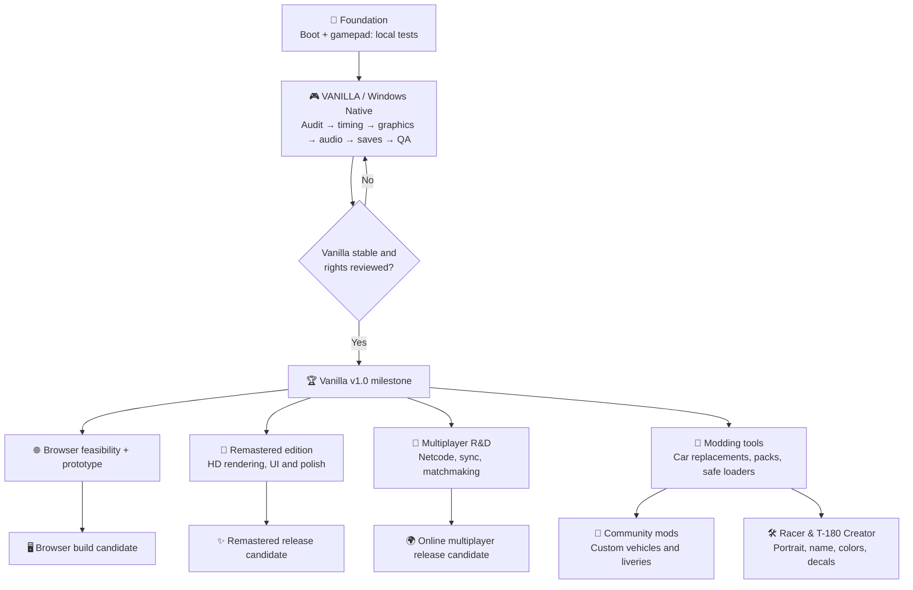

# 🏁 Speed Racer Native Port — Product Roadmap

[← Overview](README.md) · [Tasks](../../issues)

**Vision:** preserve the original PS2 experience through a faithful Windows native port (**Vanilla**); then develop optional modern experiences without compromising the original. The browser is a possible additional platform, not a promise of a hosted game.

## The big picture

**The four branches after Vanilla are independent exploratory tracks.** They may be reordered based on tests, contributors and rights. None is committed to a release date.

## Development tracks

| Track | Goal | Status | Release gate |
| --- | --- | --- | --- |
| **VANILLA** | Native Windows experience faithful to PS2, including correct game speed, visuals, audio, input and saves | 🔄 Active priority | Reproducible build, full QA, rights review |
| **REMASTERED** | Optional improved resolutions, rendering, UI and accessibility while preserving game feel | 💡 Future | Vanilla stable + visual baseline |
| **MULTIPLAYER** | Explore online races and networking feasibility | 🔬 Research backlog | Deterministic simulation/network feasibility, anti-desync tests |
| **MODDING** | Optional vehicle, texture and content packs through a safe, versioned community mod loader | 💡 Future architecture + prototype | Technical interfaces, compatible data formats and creator rights |
| **WEB** | Explore recompilation to WebAssembly/WebGPU with user-provided game data | 🔬 Feasibility | Browser compatibility, performance, storage, copyright safeguards |

## Track A — Vanilla first

### A0 · Proof of concept — 🟢 locally reported
- [x] Windows native executable starts (developer report; needs reproducible verification)
- [x] Gamepad input works locally (developer report)
- [ ] Record hardware and full gameplay evidence

### A1 · Technical baseline — 🔄 next
- [ ] Source/license inventory and dependency attribution ([issue #1](../../issues/1))
- [ ] Reproducible benchmark, profiling and simulation-vs-wall-time measurements ([#2](../../issues/2))
- [ ] Correct slow-motion and frame pacing ([#3](../../issues/3))
- [ ] Profile VU1 and GS bottlenecks ([#4](../../issues/4))

### A2 · Faithful playable build — ⏳ planned
- [ ] Match PCSX2/original PS2 visuals in reference scenes ([#5](../../issues/5))
- [ ] Restore missing effects and texture/render paths ([#6](../../issues/6))
- [ ] Confirm audio, cutscenes, saves, menus, handling and race outcomes
- [ ] Controller, keyboard, settings and crash logging

### A3 · Packaging and preservation — ⏳ planned
- [ ] Build from authorized sources on a clean Windows machine ([#7](../../issues/7))
- [ ] Versioned technical docs, known issues, test matrix, reproducible toolchain
- [ ] Review every file before distribution ([#8](../../issues/8))
- [ ] Set a release process that does **not** distribute unauthorized game-derived code or assets

**Definition of Vanilla 1.0:** game completes a representative set of races at intended game speed; controls/audio/saving work; visual output matches the original within documented limitations; clean install/build process and legal gate pass. A project milestone is **not** permission to distribute copyrighted game code.

## Track B — Remastered (recommended first expansion, subject to feasibility)

- [ ] Optional resolution scale and modern aspect ratios
- [ ] Antialiasing, filtering, post-processing and optimized graphics profiles
- [ ] UI modernization without breaking menus or accessibility
- [ ] Compare every option with Vanilla baseline; keep an authentic preset
- [ ] Avoid introducing ripped or replacement commercial assets without permission

**Why this is likely ahead of multiplayer:** builds on graphics and performance work already necessary for Vanilla. This is an engineering prioritization, not a promise.

## Track C — Multiplayer (larger experimental track)

- [ ] Determine whether native game mechanics expose stable state, or need substantial re-engineering
- [ ] Research race-state synchronization, rollback vs lockstep vs authoritative server
- [ ] Prototype two local networked clients with recorded desync metrics
- [ ] Assess lobby, reconnect, latency, security, hosting and maintenance costs
- [ ] Define scope: live online races only after a reliable minimal networking prototype

**Risks:** non-deterministic PS2 floating-point behavior, physics timing and original game architecture can make netcode far more difficult than graphics improvements.

## Track D — Browser / WebAssembly (independent feasibility track)

- [ ] Test the upstream `ps2-web-recomp` Emscripten/WebGPU path against our authorized source workflow
- [ ] Evaluate browsers, SharedArrayBuffer/cross-origin isolation, Gamepad API, audio and storage
- [ ] Benchmark loading and memory consumption, plus mobile constraints
- [ ] Decide whether local user-provided disc data and local compilation are needed
- [ ] Do **not** deploy commercial ISO, recompilation output, or hosted copyrighted content

**Opportunity:** [ps2-web-recomp](https://github.com/snuri00/ps2-web-recomp) already targets WebAssembly/WebGPU; a browser proof of concept may be possible sooner than multiplayer once Vanilla works, but needs independent testing.

## Track E — Modding ecosystem (community expansion)

**Goal:** let creators make optional, user-installed vehicles, liveries and tracks without modifying the Vanilla baseline. Examples of fan concepts include Brazilian cars; recognizable third-party fictional characters or vehicles require permission from their rights holders for public distribution.

- [ ] Research game vehicle data: asset formats, model skeletons, materials, textures, physics parameters and sound mapping
- [ ] Design a **versioned mod manifest** with mod ID, author, version, required game/runtime version, dependencies and file checksums
- [ ] Prefer isolated mod folders plus explicit opt-in loading and easy removal; protect original files
- [ ] Prototype one fully original test vehicle and one texture/livery replacement
- [ ] Document compatible asset formats (for example glTF conversion if feasible), validation tools and Blender workflow
- [ ] Add mod conflict detection, safe-mode launch and error reporting
- [ ] Investigate optional mod manager later; avoid arbitrary executable scripts in the first iteration
- [ ] Assess multiplayer mod compatibility and a controlled whitelist/checksum handshake
- [ ] Design optional shader/texture mod hooks with versioning and compatibility validation
- [ ] Investigate the [Racer & T-180 Creator](#track-e2--racer--t-180-creator-long-term-concept) as an accessible community tool

**Engineering note:** early Vanilla work should avoid hard-wiring every asset path in a way that makes future swapping impossible, but modding must not delay correct native gameplay. Adding new cars or tracks may require modifying game logic and fixed data structures, not merely swapping 3D files.

**Licensing:** community mod authors must own or have permission to distribute everything in their uploads, including trademarks and third-party fictional vehicle designs. Do not distribute extracted game files as starter templates.

## Track E2 — Racer & T-180 Creator (long-term concept)

**Goal:** a beginner-friendly garage/editor for building a fictional racer identity and customized T-180-inspired vehicle using permitted original assets. This is an optional creator tool, not part of Vanilla.

### Prototype ladder
- [ ] **Visual mod foundation:** user-installed texture packs, liveries, optional shader/post-processing presets (validated formats, reversible, Vanilla as fallback)
- [ ] **Garage MVP:** select a compatible base chassis, primary/secondary colors, decals, race number, racer name; export/share presets
- [ ] **Racer profile MVP:** choose a locally provided portrait, create a display name and profile with image cropping and data validation
- [ ] **Creator kit:** versioned template packages, mod manifest, Blender pipeline where feasible, automated asset checks
- [ ] **Expanded vehicles:** attempt new original models, materials, sounds, and tunable handling *only after* engine limits are understood
- [ ] **Online compatibility:** consent, file checksum comparison, optional fallback visuals, image moderation, privacy and no arbitrary mod code execution

### Technical gates
1. Determine whether vehicle selection, raster UI portraits and per-car materials can be changed without patching fixed-size game tables.
2. Keep user portraits on device by default; no automatic public uploads or remote image fetching.
3. Store modifications separately from game content; one-click disable and restore; ensure invalid packs cannot crash Vanilla.
4. Distinguish **cosmetic** modifications from physics-changing mods; multiplayer should use common verified gameplay data.
5. Only offer base vehicles, logos, fictional racers and other assets with appropriate redistribution rights. Transformers and branded real cars may require permission.

**Success criteria:** Create a fully original racer with custom portrait, name, livery, colors and number, drive a race, relaunch to load it, then remove the mod and return cleanly to Vanilla. No extra game assets are included in the repository.

## Track F — Camera, Photo & Replay Experience (priority expansion)

**Product decision:** cinematic and functional cameras are more valuable near-term than a full vehicle creation garage. Keep Garage Studio in the long-term concepts, not the near-term queue.

### F1 — In-race camera options (first exploration after Vanilla fidelity)
- [ ] Document existing camera logic, coordinate systems, clipping/collision and controller inputs
- [ ] Test chase-camera distance/height/FOV, hood/front view, cockpit only if relevant geometry exists, and cinematic preset
- [ ] Implement per-camera toggles with safe boundaries, reset and no physics/gameplay alterations
- [ ] Save user preference without changing Vanilla defaults

### F2 — Photo Mode (high priority after stable graphics)
- [ ] Pause safely in supported modes; test whether simulation, particles and animation can be frozen independently
- [ ] Camera translate/orbit/zoom/roll, FOV, depth of field, exposure, hide HUD
- [ ] Capture screenshots at supported resolutions with a graceful fallback
- [ ] Protect race timing and physics from photo-mode pause and restore

### F3 — Replay Studio (high priority, higher technical uncertainty)
- [ ] Audit the game's existing replay storage/playback and whether full vehicle transforms are recorded
- [ ] First prototype **camera selection during existing replays** (chase, trackside, orbit/free camera if feasible)
- [ ] Explore timeline controls, pause, scrub, slow motion and vehicle switching, with fidelity checks
- [ ] If existing replay data is insufficient, research deterministic inputs vs snapshot/state recording with memory/storage budgets
- [ ] Optional video export only after replay correctness and rendering stability

### F4 — Ghost Racing (medium priority)
- [ ] Prototype recording a local player's lap with timestamps and vehicle trajectory
- [ ] Playback transparent ghost isolated from collisions and race outcomes
- [ ] Compare lap timing and save/load recordings by game version and track
- [ ] Only explore online ghosts/leaderboards after privacy, anti-cheat and backend costs are evaluated

**Dependency order:** Vanilla fidelity → camera hooks → Photo Mode + replay camera prototype → Replay Studio → Ghost Racing (may run in parallel if feasible).

**Technical caution:** existing native replays may not store enough scene state for arbitrarily moving the camera or scrubbing. A camera toggle is not promised until inspected; new replay recording may require substantial simulation instrumentation.

## Progress philosophy

| Signal | Meaning |
| --- | --- |
| 🟢 Verified | Acceptance tests and evidence linked |
| 🔄 Active | Work started, no completion claim |
| ⏳ Planned | Scoped but not started |
| 🔬 Research | Feasibility unresolved |
| 🔒 Blocked | Legal, technical or verification gate |

**No fake percentages.** Progress is tracked through closed issues, reproduced tests, build SHAs, and accepted milestones.

## Contribution rules

Report issues with: **steps to reproduce → expected/actual → hardware & build → logs → comparison/test → outcome**. Never attach copyrighted game data or confidential assets. See [CONTRIBUTING.md](CONTRIBUTING.md).
