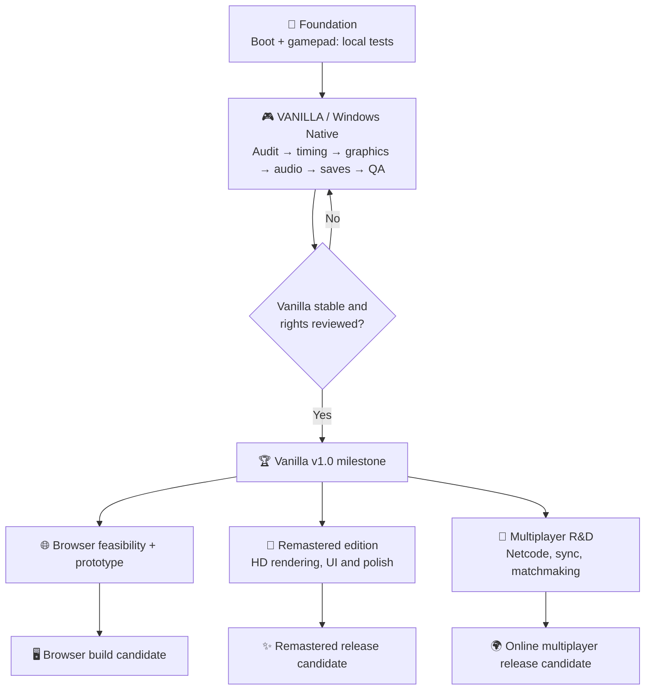

# 🏁 Speed Racer Native Port — Product Roadmap

[← Overview](README.md) · [Tasks](../../issues)

**Vision:** preserve the original PS2 experience through a faithful Windows native port (**Vanilla**); then develop optional modern experiences without compromising the original. The browser is a possible additional platform, not a promise of a hosted game.

## The big picture

**The three branches after Vanilla are independent exploratory tracks.** They may be reordered based on tests, contributors and rights. None is committed to a release date.

## Development tracks

| Track | Goal | Status | Release gate |
| --- | --- | --- | --- |
| **VANILLA** | Native Windows experience faithful to PS2, including correct game speed, visuals, audio, input and saves | 🔄 Active priority | Reproducible build, full QA, rights review |
| **REMASTERED** | Optional improved resolutions, rendering, UI and accessibility while preserving game feel | 💡 Future | Vanilla stable + visual baseline |
| **MULTIPLAYER** | Explore online races and networking feasibility | 🔬 Research backlog | Deterministic simulation/network feasibility, anti-desync tests |
| **WEB** | Explore recompilation to WebAssembly/WebGPU with user-provided game data | 🔬 Feasibility | Browser compatibility, performance, storage, copyright safeguards |

## Track A — Vanilla first

### A0 · Proof of concept — 🟢 locally reported
- [x] Windows native executable starts (developer report; needs reproducible verification)
- [x] Gamepad input works locally (developer report)
- [ ] Record hardware and full gameplay evidence

### A1 · Technical baseline — 🔄 next
- [ ] Source/license inventory and dependency attribution ([issue #1](../../issues/1))
- [ ] Reproducible benchmark, profiling and simulation-vs-wall-time measurements ([#2](../../issues/2))
- [ ] Correct slow-motion and frame pacing ([#3](../../issues/3))
- [ ] Profile VU1 and GS bottlenecks ([#4](../../issues/4))

### A2 · Faithful playable build — ⏳ planned
- [ ] Match PCSX2/original PS2 visuals in reference scenes ([#5](../../issues/5))
- [ ] Restore missing effects and texture/render paths ([#6](../../issues/6))
- [ ] Confirm audio, cutscenes, saves, menus, handling and race outcomes
- [ ] Controller, keyboard, settings and crash logging

### A3 · Packaging and preservation — ⏳ planned
- [ ] Build from authorized sources on a clean Windows machine ([#7](../../issues/7))
- [ ] Versioned technical docs, known issues, test matrix, reproducible toolchain
- [ ] Review every file before distribution ([#8](../../issues/8))
- [ ] Set a release process that does **not** distribute unauthorized game-derived code or assets

**Definition of Vanilla 1.0:** game completes a representative set of races at intended game speed; controls/audio/saving work; visual output matches the original within documented limitations; clean install/build process and legal gate pass. A project milestone is **not** permission to distribute copyrighted game code.

## Track B — Remastered (recommended first expansion, subject to feasibility)

- [ ] Optional resolution scale and modern aspect ratios
- [ ] Antialiasing, filtering, post-processing and optimized graphics profiles
- [ ] UI modernization without breaking menus or accessibility
- [ ] Compare every option with Vanilla baseline; keep an authentic preset
- [ ] Avoid introducing ripped or replacement commercial assets without permission

**Why this is likely ahead of multiplayer:** builds on graphics and performance work already necessary for Vanilla. This is an engineering prioritization, not a promise.

## Track C — Multiplayer (larger experimental track)

- [ ] Determine whether native game mechanics expose stable state, or need substantial re-engineering
- [ ] Research race-state synchronization, rollback vs lockstep vs authoritative server
- [ ] Prototype two local networked clients with recorded desync metrics
- [ ] Assess lobby, reconnect, latency, security, hosting and maintenance costs
- [ ] Define scope: live online races only after a reliable minimal networking prototype

**Risks:** non-deterministic PS2 floating-point behavior, physics timing and original game architecture can make netcode far more difficult than graphics improvements.

## Track D — Browser / WebAssembly (independent feasibility track)

- [ ] Test the upstream `ps2-web-recomp` Emscripten/WebGPU path against our authorized source workflow
- [ ] Evaluate browsers, SharedArrayBuffer/cross-origin isolation, Gamepad API, audio and storage
- [ ] Benchmark loading and memory consumption, plus mobile constraints
- [ ] Decide whether local user-provided disc data and local compilation are needed
- [ ] Do **not** deploy commercial ISO, recompilation output, or hosted copyrighted content

**Opportunity:** [ps2-web-recomp](https://github.com/snuri00/ps2-web-recomp) already targets WebAssembly/WebGPU; a browser proof of concept may be possible sooner than multiplayer once Vanilla works, but needs independent testing.

## Progress philosophy

| Signal | Meaning |
| --- | --- |
| 🟢 Verified | Acceptance tests and evidence linked |
| 🔄 Active | Work started, no completion claim |
| ⏳ Planned | Scoped but not started |
| 🔬 Research | Feasibility unresolved |
| 🔒 Blocked | Legal, technical or verification gate |

**No fake percentages.** Progress is tracked through closed issues, reproduced tests, build SHAs, and accepted milestones.

## Contribution rules

Report issues with: **steps to reproduce → expected/actual → hardware & build → logs → comparison/test → outcome**. Never attach copyrighted game data or confidential assets. See [CONTRIBUTING.md](CONTRIBUTING.md).
