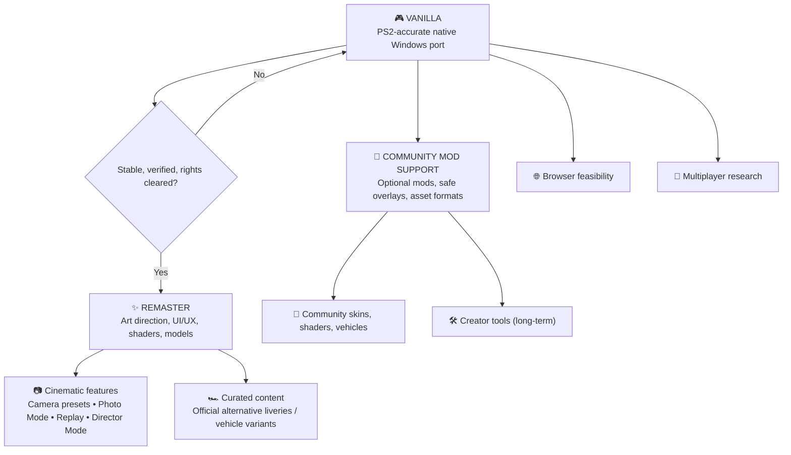

# 🏁 Speed Racer Native Port — Development Roadmap

[Overview](README.md) · [Open issues](../../issues) · [UI/UX concept brief](docs/REMASTER_UI_UX.md)

> **Vision:** Preserve the original PS2 game through a faithful native PC port (**Vanilla**). Then create a thoughtfully redesigned, improved **Remaster**. Community **Mods** remain separate, optional extensions. Online and browser support are longer-term research directions. No release dates are promised.

## Current engineering milestone — quality and stability

Updated 2026-10-31. The playable release is **v0.1.0**; its published source
baseline is **source-v0.1.0**. The next candidate is v0.1.1 after appropriate
verification, not a scheduled release. Read the [architecture](docs/ARCHITECTURE.md)
and [code quality rules](docs/CODE_QUALITY.md) before contributing.

| Order | Work | Completion evidence |
| --- | --- | --- |
| 1 | Architecture, attribution and development transparency | Clear component boundaries, upstream credit and substantial AI-assistance disclosure |
| 2 | Contribution quality | Small auditable PRs, generated/imported/manual boundaries, reasoned review and relevant tests |
| 3 | Clean builds and automated verification | A fresh Windows checkout builds; tests and unavailable hardware checks are reported accurately; workflows use read-only permissions |
| 4 | CPU compatibility | Audit host/VU/GS requirements and early failure; do not promise a non-AVX2 build before correctness/performance verification |
| 5 | Incremental maintainability | Extract one diagnostic/configuration responsibility without changing arithmetic, timing or packet order |
| 6 | Targeted stability fixes | Reproduce audio-category/transition, pause cadence and hitch issues separately and compare the same inputs/settings |
| 7 | v0.1.1 candidate | Record source/dependencies, tests and focused integrated-package checks; disclose remaining limitations and preserve the previous release |

Steps 1–4 are the first engineering milestone. Documentation or workflow changes
alone are not a new gameplay-performance release. A reproducible functional bug
can take priority over refactoring. See [existing issue triage](docs/BACKLOG.md),
[CI scope](docs/CI.md) and [CPU compatibility](docs/CPU_COMPATIBILITY.md).

The future concepts below are not near-term delivery commitments or a finished
mod SDK. New cars, tracks and multiplayer need separate feasibility work.

## 🗺️ At a glance

These are conceptual branches; feature feasibility and distribution permissions must be assessed separately.

## Product identity and boundaries

| Edition / track | Purpose | Included examples | Priority |
| --- | --- | --- | --- |
| **Vanilla** | Faithful preservation | Original UI, camera, assets, physics, timing, graphics, sound, input and saves | 🔄 **Now** |
| **Remaster Core** | A curated, polished modern edition | Complete UI/UX redesign, refined shaders/materials, lighting/VFX, optimized and refined 3D models, HD rendering | ⏳ **After Vanilla** |
| **Remaster Features** | First-party experience improvements | F1-style configurable cameras, Photo Mode, improved replay, Director Mode, optional Ghost Racing | 💡 Future |
| **Remaster Content** | First-party curated additions | Optional alternative skins/liveries; e.g. red heritage variant or black/yellow Racer X-inspired Match 6 concept | 💡 Future |
| **Community Mods** | Optional third-party contributions | Reversible livery/skin packs, shader/texture mods, custom models, optional creator tools | 🔬 Future |
| **Multiplayer / Web** | Independent platform and netcode R&D | Online races, browser build feasibility | 🔬 Research |

**Rule:** The same category of asset can belong to Remaster *or* Mods. Classification depends on integration and curation: first-party variants shipped as part of an authorized Remaster are **Remaster content**; optional user-installed community packs are **Mods**. The Vanilla baseline stays unchanged.

## Phase 0 — Windows proof of concept (local validation)

- [x] Windows GUI executable launches without a console window
- [x] Controller integration implemented; maintainer confirmed a physical controller
- [x] Local source/runtime inventory and measured build environment documented
- [ ] Independent reproduction and complete dependency/provenance review

## Phase 1 — Integrated Vanilla robustness (CURRENT)

**Current baseline: playable v0.1.0 and source-v0.1.0.** The integrated v38
conversion was an earlier milestone; subsequent accepted fixes and the ergonomic
keyboard preset are included in the published release. Its integrated data opens
without selecting or mounting an ISO. The [v38 update](docs/updates/vanilla-integrada-v38.md)
is historical, not the current build identity.

- [x] Integrated data package and native Windows startup without an ISO prompt
- [x] Preserve High 3×, bilinear HUD/textures, FXAA, audio, controllers and adaptive fullscreen
- [x] Verify the converted data and compare captured Fuji image/generated audio between storage formats
- [x] Implement repeatable isolated candidate preparation, integrity verification and explicit profile copying
- [x] Receive a positive external Windows test report (earlier package; not exhaustive acceptance of every later build/device)
- [ ] Fix concrete issues revealed by real sessions and compare with the accepted baseline
- [ ] Close targeted coverage gaps in longer sessions, remaining classes and Mirror
- [ ] Finalize update/package preparation that preserves player progress and settings
- [x] Publish the experimental Vanilla v0.1.0 and corresponding source snapshot

The [playable v0.1.0](https://github.com/killeiro/Speed-Racer-Native-Port/releases/tag/v0.1.0)
is public. Audio categories/transitions, pause cadence and occasional hitches
remain follow-ups. Publication and earlier external feedback do not certify
every track, complete visual parity, sustained 60 FPS or every input device.

Engineering now focuses on clean builds, code quality and targeted stability.
New renderer or timing changes require a concrete issue and focused verification.
Remaster and mods follow a stable Vanilla baseline.

**Vanilla completion target:** repeatable startup, full-race results, saving/reopening, sound, controls and display behavior in normal and longer sessions on the tested machines, with no known blocking defect.

## Phase 2 — Remaster Core: visual and interface modernization

**Design ownership:** The maintainer will lead the modern UI/UX redesign. Treat the [HUD concept brief](docs/REMASTER_UI_UX.md) as visual direction, *not* a final approved interface or an in-engine implementation.

### Modern UI/UX
- [ ] Inventory all screens: launch, menus, garage/selection, settings, loading, race HUD, pause, results, replay
- [ ] Define an accessible design system: typography, spacing, contrast, responsive safe areas, motion and controller focus states
- [ ] Redesign HUD without overwhelming the driving view: rank/time gaps, lap, contextual radio message, speed, gear, boost, health
- [ ] Build Figma prototypes, test gameplay readability, implement renderable UI components and regression tests
- [ ] Maintain a toggle or separate edition boundary where technically feasible so Vanilla remains visually faithful

### Rendering and assets
- [ ] HD scaling, frame pacing, options and anti-aliasing
- [ ] Refine shaders, illumination, VFX, reflections and materials while retaining the game's art direction
- [ ] Improve 3D model detail/LOD and texture quality where supported and legally distributable
- [ ] Benchmark GPU cost, memory, visual differences and fallback presets

### Curated vehicle variants
- [ ] Explore official Remaster liveries and cosmetic-only variants without changing car physics
- [ ] Investigate red Match 4-inspired Match 6 and black/yellow Racer X-inspired Match 6 concepts as **proposals**, not shipped content
- [ ] Verify permitted use of original game characters, names, trademarks and likenesses before distribution
- [ ] Distinguish first-party Remaster variants from user-made mod packs

## Phase 3 — Remaster Features: cameras and cinematic tools
- [ ] **Adjustable cameras**: chase distance/height/FOV, optional front/cockpit if supported ([#13](../../issues/13))
- [ ] **Photo Mode**: free/orbit camera, pause safety, HUD visibility, FOV/DOF, screenshot ([#14](../../issues/14))
- [ ] **Replay Studio**: investigate native replay data, switch camera during replay, seek/slow motion if technically possible ([#15](../../issues/15))
- [ ] **Director Mode**: presets/automatic cinematic cuts during replays, trackside views, subject switching; depends on viable replay/camera hooks
- [ ] **Ghost Racing**: local time-trial ghost without collisions ([#16](../../issues/16))

## Phase 4 — Community Mod Support (parallel architecture research; shipping later)
- [ ] Versioned manifest and isolated, reversible mod packages ([#10](../../issues/10))
- [ ] Shader and texture mod compatibility ([#11](../../issues/11))
- [ ] Cosmetic vehicle skin/livery pipeline ([#17](../../issues/17))
- [ ] Optional creator tools and racer portrait / car customization are **low-priority long-term**, not a near-term Garage Studio commitment ([#12](../../issues/12))
- [ ] Prevent broken mod packs from corrupting Vanilla and research multiplayer checksum compatibility
- [ ] Require contributors to have redistribution rights for submitted content

## Phase 5 — Exploration
- [ ] Online multiplayer: authoritative simulation, deterministic behavior, latency and anti-desync testing
- [ ] Browser/WebGPU/WebAssembly: performance, security, local data access and copyright safeguards

## Progress policy

| Marker | Meaning |
| --- | --- |
| ✅ Verified | Finished, tested, linked evidence |
| 🔄 Active | Work in progress |
| ⏳ Planned | Defined; not implemented |
| 🔬 Research | Feasibility unknown |
| 🔒 Gated | Needs technical, QA or legal review |

No made-up completion percentages. Issues, source/build identities and scoped
measurements are the source of truth. Repository source, generated inputs,
external dependencies and downloadable playable artifacts have distinct
provenance; see [SOURCE-PROVENANCE.md](docs/SOURCE-PROVENANCE.md). Do not upload
game data, personal saves or build outputs in contribution PRs.

