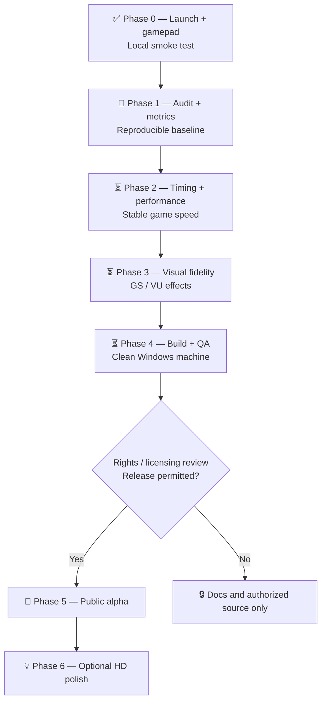

# 🏁 Development Roadmap

[← Project overview](README.md) · [Active issues](../../issues)

> The roadmap is a plan, **not** a claim of completed engineering work. A phase is complete only when its acceptance criteria have evidence attached to a commit or issue.

## Visual progress board

| Phase | Progress | Status | Definition of done |
| --- | --- | --- | --- |
| 0 · Boot/input | `██████████` | ✅ Local report | Boot + menu + gamepad demonstrated |
| 1 · Audit | `░░░░░░░░░░` | 🔄 Prioritized | Source inventory, baseline logs and profiler |
| 2 · Performance | `░░░░░░░░░░` | ⏳ Planned | Correct simulated game speed, measured frame-time stability |
| 3 · Graphics | `░░░░░░░░░░` | ⏳ Planned | Scene-by-scene parity checklist and resolved regressions |
| 4 · Windows QA | `░░░░░░░░░░` | ⏳ Planned | Independent build and clean-machine smoke test |
| 5 · Public alpha | `░░░░░░░░░░` | 🔒 Blocked | Rights clearance and verified packaging |
| 6 · HD enhancements | `░░░░░░░░░░` | 💡 Backlog | Opt-in rendering features with no gameplay regressions |

*Progress bars are stage indicators, not measured percentages.*

### Phase 1 — Source audit & profiling
- [ ] Import or link **authorized** build/runtime sources with attribution and license review.
- [ ] Freeze a baseline build SHA and record compiler, GPU, driver and OS.
- [ ] Add frame-time histogram, simulation time vs wall clock, GPU/CPU timings, GS calls and VU1 execution mode.
- [ ] Compare menu, gameplay, race start, effects-heavy scene and pause/resume.
- [ ] Record reproducible baseline in [test plan](docs/TEST_PLAN.md).

### Phase 2 — Game speed and responsiveness
- [ ] Separate game clock from presentation clock and identify whether VSync or render stalls throttle simulation.
- [ ] Inspect VU1 interpreter/JIT/precompiled paths, GS dispatch batching, and avoid CPU/GPU readback where possible.
- [ ] Test audio underruns and controller latency.
- [ ] Record before/after measurements and check that physics/game logic remain at original speed.

### Phase 3 — Original PS2 visual behavior
- [ ] Compare same scene under PCSX2 (reference) and native renderer.
- [ ] Audit textures, CLUT, alpha blending, depth, fog, particles, shading and VU outputs.
- [ ] Maintain side-by-side visual regression evidence.
- [ ] Avoid adding HD features before original render paths are faithful.

### Phase 4 — Windows build & quality
- [ ] Clean checkout build steps, dependency versions and deterministic packaging.
- [ ] Controller mapping, keyboard fallback, fullscreen/windowed, logs and crashes.
- [ ] Test on second Windows machine without developer directories or hard-coded paths.

### Phase 5 — Community alpha (release gate)
- [ ] Verify that **every distributed file** may lawfully be distributed.
- [ ] Publish instructions for using legitimately obtained data *without redistributing game assets*.
- [ ] Version/tag release, checksums, known issues and feedback instructions.
- [ ] Do not publish a binary until all gates pass.

### Phase 6 — Optional enhancements
- [ ] Scalable internal resolution, texture filtering, anti-aliasing.
- [ ] Graphics presets, UI polish and accessibility.
- [ ] Consider higher-scope features only after stable core gameplay.

## Working process

Each task should have a GitHub issue with **reproduction steps → baseline → fix → measurements → regression test**. Keep the checkboxes and issue statuses current; **do not mark a task done based on expectation alone**.
