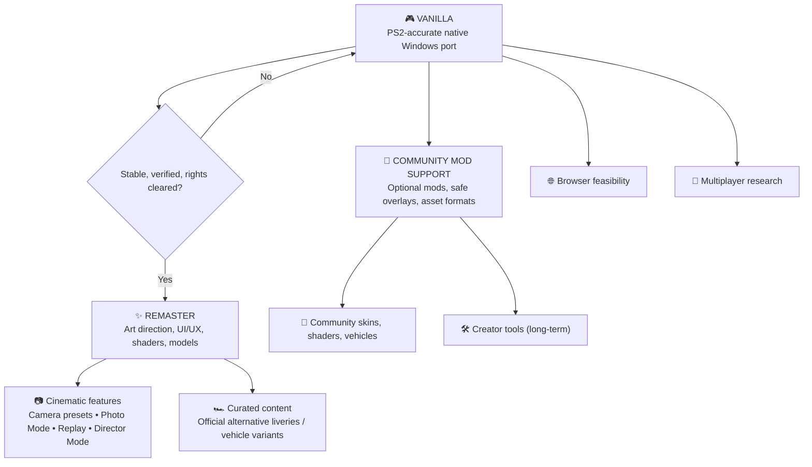

# 🏁 Speed Racer Native Port — Development Roadmap

[Overview](README.md) · [Open issues](../../issues) · [UI/UX concept brief](docs/REMASTER_UI_UX.md)

> **Vision:** Preserve the original PS2 game through a faithful native PC port (**Vanilla**). Then create a thoughtfully redesigned, improved **Remaster**. Community **Mods** remain separate, optional extensions. Online and browser support are longer-term research directions. No release dates are promised.

## 🗺️ At a glance

These are conceptual branches; feature feasibility and distribution permissions must be assessed separately.

## Product identity and boundaries

| Edition / track | Purpose | Included examples | Priority |
| --- | --- | --- | --- |
| **Vanilla** | Faithful preservation | Original UI, camera, assets, physics, timing, graphics, sound, input and saves | 🔄 **Now** |
| **Remaster Core** | A curated, polished modern edition | Complete UI/UX redesign, refined shaders/materials, lighting/VFX, optimized and refined 3D models, HD rendering | ⏳ **After Vanilla** |
| **Remaster Features** | First-party experience improvements | F1-style configurable cameras, Photo Mode, improved replay, Director Mode, optional Ghost Racing | 💡 Future |
| **Remaster Content** | First-party curated additions | Optional alternative skins/liveries; e.g. red heritage variant or black/yellow Racer X-inspired Match 6 concept | 💡 Future |
| **Community Mods** | Optional third-party contributions | Reversible livery/skin packs, shader/texture mods, custom models, optional creator tools | 🔬 Future |
| **Multiplayer / Web** | Independent platform and netcode R&D | Online races, browser build feasibility | 🔬 Research |

**Rule:** The same category of asset can belong to Remaster *or* Mods. Classification depends on integration and curation: first-party variants shipped as part of an authorized Remaster are **Remaster content**; optional user-installed community packs are **Mods**. The Vanilla baseline stays unchanged.

## Phase 0 — Windows proof of concept (local validation)

- [x] Windows GUI executable launches without a console window
- [x] Controller integration implemented; maintainer confirmed a physical controller
- [x] Local source/runtime inventory and measured build environment documented
- [ ] Independent reproduction and complete dependency/provenance review

## Phase 1 — Vanilla stabilization (CURRENT)

Status updated **2026-10-19**. [Evidence index](docs/audit/README.md) · [Current P0/P1 tasks](docs/audit/next-10-tasks.md).

- [x] Separate EE simulation timing from presentation callbacks; capture percentiles and environment
- [x] Fix DATE/CT24 and delayed VU MSKPATH3 regressions with focused tests
- [x] Implement mipmapping/LOD/filtering and relevant GS hazard tests
- [x] Implement selective native VU continuations with pipeline/code-generation validation
- [x] Reduce VIF NOP/MASK=0 and Q-analysis overhead, with controlled measurements
- [x] Capture 36 Class 1 route checkpoints and run short 600-VBlank performance samples
- [x] Reuse VIF parser context per synchronous call; compare against the frozen prior parser
- [x] Pass 21 local tests, VU/VIF/Q differential checks and 12-image regression in v7
- [x] Audit VU register/helper separation and validate compiler optimization over the same 37 continuation bodies
- [x] Add native threaded VU/Q diagnostic checks in Fuji and Grand Prix; retain noisy grouped runs alongside adjacent comparisons
- [x] Investigate audio/deadline pacing with same-binary comparisons; retain adverse results and keep v8 opt-in
- [x] Add repeatable pacing comparison helper, pass 22 local tests and 12-image regression
- [x] Reuse unchanged GS descriptors; validate original-comparison payload equivalence,23 tests and12 unchanged images
- [x] Warm both binaries at the same path before paired measurements; run36 native short route windows in v9
- [x] Specialize CL=0 VIF fills after profiling; validate 69,168 differential cases, 23 tests, images, native pairs and 36 short route windows in v10
- [x] Validate exact SSE2 VU code equality with2,308,915 cases, real cache mutations,25 tests, images, five paired scenes and36 short route windows in v11
- [x] Trace the live active-scene clock and validate optional native telemetry through active/pause/resume cases; original cadence still open
- [ ] Sustain intended simulation speed and acceptable p95/p99 in all relevant scenes ([#2](../../issues/2), [#3](../../issues/3), [#4](../../issues/4))
- [ ] Confirm original cadence using the live scene clock; complete laps/races, classes 2–4, Mirror and 30-minute sessions
- [ ] Match five original/native scenes at 1x and close active graphics gaps ([#5](../../issues/5), [#6](../../issues/6))
- [ ] Verify actual audio underruns, physical input latency, pause/restart, saves and shutdown
- [ ] Reproducible Windows build and launch on a clean machine without development fallbacks ([#7](../../issues/7))
- [ ] Complete source/dependency provenance and distribution review ([#1](../../issues/1), [#8](../../issues/8))

**Performance remains P0.** Fuji, Grand Prix and some Skorost/Thunderhead samples still run below target. A 600-VBlank route sample is approximately ten simulated seconds; it does not validate every section of a track or a full race. V11 separately validates an active-scene clock; original PS2 cadence and per-player lap/result timing remain unconfirmed. Pre-present callbacks do not measure scanout. Regression agreement does not establish PS2 accuracy.

**Vanilla definition of done:** repeatable tests show intended speed and original graphics, menus, physics, audio, controls and saving over typical full races and long sessions; authorized packaging passes clean-machine QA. These acceptance gates remain open. No milestone overrides distribution rights.

## Phase 2 — Remaster Core: visual and interface modernization

**Design ownership:** The maintainer will lead the modern UI/UX redesign. Treat the [HUD concept brief](docs/REMASTER_UI_UX.md) as visual direction, *not* a final approved interface or an in-engine implementation.

### Modern UI/UX
- [ ] Inventory all screens: launch, menus, garage/selection, settings, loading, race HUD, pause, results, replay
- [ ] Define an accessible design system: typography, spacing, contrast, responsive safe areas, motion and controller focus states
- [ ] Redesign HUD without overwhelming the driving view: rank/time gaps, lap, contextual radio message, speed, gear, boost, health
- [ ] Build Figma prototypes, test gameplay readability, implement renderable UI components and regression tests
- [ ] Maintain a toggle or separate edition boundary where technically feasible so Vanilla remains visually faithful

### Rendering and assets
- [ ] HD scaling, frame pacing, options and anti-aliasing
- [ ] Refine shaders, illumination, VFX, reflections and materials while retaining the game's art direction
- [ ] Improve 3D model detail/LOD and texture quality where supported and legally distributable
- [ ] Benchmark GPU cost, memory, visual differences and fallback presets

### Curated vehicle variants
- [ ] Explore official Remaster liveries and cosmetic-only variants without changing car physics
- [ ] Investigate red Match 4-inspired Match 6 and black/yellow Racer X-inspired Match 6 concepts as **proposals**, not shipped content
- [ ] Verify permitted use of original game characters, names, trademarks and likenesses before distribution
- [ ] Distinguish first-party Remaster variants from user-made mod packs

## Phase 3 — Remaster Features: cameras and cinematic tools
- [ ] **Adjustable cameras**: chase distance/height/FOV, optional front/cockpit if supported ([#13](../../issues/13))
- [ ] **Photo Mode**: free/orbit camera, pause safety, HUD visibility, FOV/DOF, screenshot ([#14](../../issues/14))
- [ ] **Replay Studio**: investigate native replay data, switch camera during replay, seek/slow motion if technically possible ([#15](../../issues/15))
- [ ] **Director Mode**: presets/automatic cinematic cuts during replays, trackside views, subject switching; depends on viable replay/camera hooks
- [ ] **Ghost Racing**: local time-trial ghost without collisions ([#16](../../issues/16))

## Phase 4 — Community Mod Support (parallel architecture research; shipping later)
- [ ] Versioned manifest and isolated, reversible mod packages ([#10](../../issues/10))
- [ ] Shader and texture mod compatibility ([#11](../../issues/11))
- [ ] Cosmetic vehicle skin/livery pipeline ([#17](../../issues/17))
- [ ] Optional creator tools and racer portrait / car customization are **low-priority long-term**, not a near-term Garage Studio commitment ([#12](../../issues/12))
- [ ] Prevent broken mod packs from corrupting Vanilla and research multiplayer checksum compatibility
- [ ] Require contributors to have redistribution rights for submitted content

## Phase 5 — Exploration
- [ ] Online multiplayer: authoritative simulation, deterministic behavior, latency and anti-desync testing
- [ ] Browser/WebGPU/WebAssembly: performance, security, local data access and copyright safeguards

## Progress policy

| Marker | Meaning |
| --- | --- |
| ✅ Verified | Finished, tested, linked evidence |
| 🔄 Active | Work in progress |
| ⏳ Planned | Defined; not implemented |
| 🔬 Research | Feasibility unknown |
| 🔒 Gated | Needs technical, QA or legal review |

No made-up completion percentages. Issues, build SHA, benchmarks, screenshots and tests are the source of truth. **No commercial PS2 ISO, copyrighted assets or game-derived binaries are being published here.**

