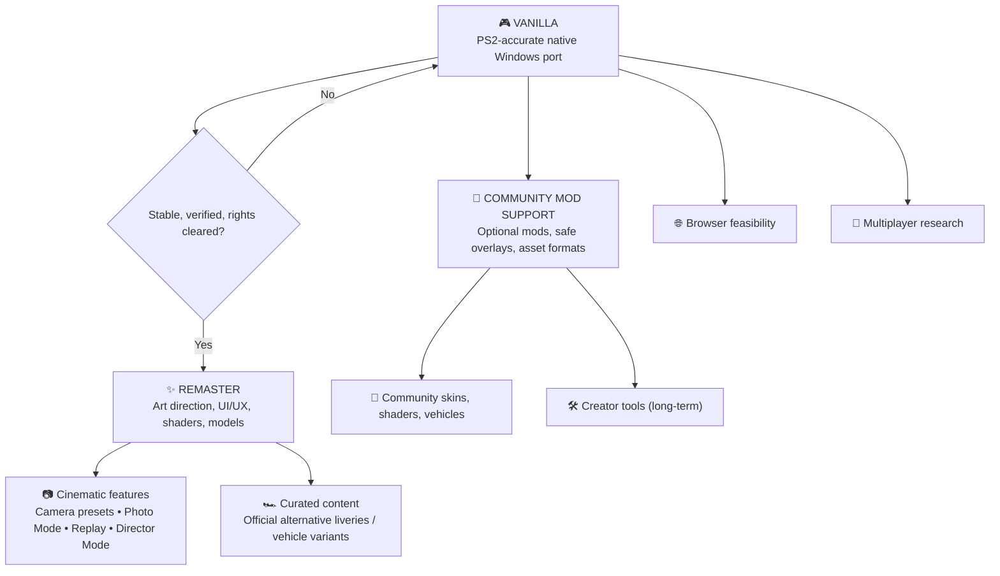

# 🏁 Speed Racer Native Port — Development Roadmap

[Overview](README.md) · [Open issues](../../issues) · [UI/UX concept brief](docs/REMASTER_UI_UX.md)

> **Vision:** Preserve the original PS2 game through a faithful native PC port (**Vanilla**). Then create a thoughtfully redesigned, improved **Remaster**. Community **Mods** remain separate, optional extensions. Online and browser support are longer-term research directions. No release dates are promised.

## 🗺️ At a glance

These are conceptual branches; feature feasibility and distribution permissions must be assessed separately.

## Product identity and boundaries

| Edition / track | Purpose | Included examples | Priority |
| --- | --- | --- | --- |
| **Vanilla** | Faithful preservation | Original UI, camera, assets, physics, timing, graphics, sound, input and saves | 🔄 **Now** |
| **Remaster Core** | A curated, polished modern edition | Complete UI/UX redesign, refined shaders/materials, lighting/VFX, optimized and refined 3D models, HD rendering | ⏳ **After Vanilla** |
| **Remaster Features** | First-party experience improvements | F1-style configurable cameras, Photo Mode, improved replay, Director Mode, optional Ghost Racing | 💡 Future |
| **Remaster Content** | First-party curated additions | Optional alternative skins/liveries; e.g. red heritage variant or black/yellow Racer X-inspired Match 6 concept | 💡 Future |
| **Community Mods** | Optional third-party contributions | Reversible livery/skin packs, shader/texture mods, custom models, optional creator tools | 🔬 Future |
| **Multiplayer / Web** | Independent platform and netcode R&D | Online races, browser build feasibility | 🔬 Research |

**Rule:** The same category of asset can belong to Remaster *or* Mods. Classification depends on integration and curation: first-party variants shipped as part of an authorized Remaster are **Remaster content**; optional user-installed community packs are **Mods**. The Vanilla baseline stays unchanged.

## Phase 0 — Windows proof of concept (local validation)

- [x] Windows GUI executable launches without a console window
- [x] Controller integration implemented; maintainer confirmed a physical controller
- [x] Local source/runtime inventory and measured build environment documented
- [ ] Independent reproduction and complete dependency/provenance review

## Phase 1 — Vanilla stabilization (CURRENT)

Status updated **2026-10-20**. [Evidence index](docs/audit/README.md) · [Current P0/P1 tasks](docs/audit/next-10-tasks.md).

**Latest iteration — [v23 build integrity](docs/audit/vanilla-v23.md), private build v17:** restore310 extra VU programs, reproduce the frozen reference after VU rebuild/relink, and add an always-run SHA/count manifest guard.32 tests plus the actual partial-source/old-mtime rejection pass.56 normalization controls remain but also contain a coverage confound. The candidate is not promoted. Generated coverage is restored and guarded; exact v17 remains playable. The timing comparison also contains a native-coverage confound. Next: audit PCSX2/native-port architecture and generated inputs in a clean build before further optimization, then residual GS/VU/cadence and full-game acceptance. The128-bit invalidation gap remains separate; no unchanged-build manual round.

**Previous iteration — [v21 diagnosis](docs/audit/vanilla-v21.md) / [v22 discriminator](docs/audit/vanilla-v22.md), current private build v17:** publication wait is attributed to pending-frame pressure, with VU CPU limiting Fuji and GS/VU balanced in Skorost. One shared mismatch word only rejects incompatible variants; all acceptance still validates reachable code.31 tests,21.08M native checks,three WAV pairs and56 warmed performance windows retain adverse evidence. The candidate fails the predeclared screen, stays isolated, and exact v17 source/EXE remain current. Whole-game/cadence/result-save/original1x/physical-input and second-PC gates remain open.

**Controller baseline round — 2026-10-20:** Six separate v17 sessions are analyzed, one per environment, with76,301 VBlanks and normal drain/join/card preservation. Fuji averages58.13FPS with a48.34FPS five-second bucket; near60 means elsewhere retain cadence spikes. See the [six-environment evidence](docs/audit/vanilla-v20.md#seis-sessões-da-equipe-no-exe-de-referência-v17). Next automatic diagnosis separates VU/GS publication waits from audio pacing before a bounded correction. No new unchanged-build manual round is requested. Full races/results/save/readback, classes/Mirror, continuous30min, original timing/1x graphics and second-PC gates stay open.

**Previous audit — [v20](docs/audit/vanilla-v20.md), current private build v17:** exact VU rejection is combined with a512-sample Windows audio request.31 tests,21.08M fresh reference decisions and three generated-WAV pairs pass. The combined candidate fails the prior performance screen, stays isolated, and exact v17 remains current. No new v20 image/route matrix or gameplay package follows rejection. All56 warmed windows remain; no retrospective waiver of v18/v19 or clock/physics compensation. Next P0: preserve throughput and regular delivery together, then independently verify race result/save/readback and whole-race timing, classes/Mirror/continuous30min, original1x graphics/aliasing, physical audio/input and another Windows/GPU.

**Previous audit — [v19](docs/audit/vanilla-v19.md), gameplay build still v17:** adaptive rejection cuts repeated VU comparisons while retaining complete acceptance checks.31 tests and21.08M native decisions pass; Fuji-4/3 throughput gains meet prior gates, but Skorost-1 callback p99 worsens10–14% in all three pairs. Experiment isolated; exact v17 restored. Controller-driven candidate Fuji session:59.20 mean simulated FPS, victory from last reported, two five-second blocks below55 (minimum49.42). Human sessions are descriptive, not paired. Next P0: combine throughput protection with regular frame delivery, then independently verify race-result/save/readback and whole-race timing, classes/Mirror/continuous30min. No post-hoc gate waiver, graphics downgrade or clock acceleration.

**Previous audit — [v18](docs/audit/vanilla-v18.md), current gameplay build v17:** the256-frame audio request fails its predeclared Fuji FPS guard and remains isolated.31 candidate tests and all56 warmed comparison windows are retained. Two new human sessions produce61,327 VBlanks, near60 mean simulation FPS and residual callback tails; the maintainer reports a keyboard victory and the next session recognizes an Xbox360 controller. Seven independent native active/pause/state-reload/resume/effects cases extend QA. Scene-clock versus wall-clock differences are unresolved; neither controller causation nor original cadence is established. Next P0: Fuji backpressure/GS-VU cost, audio-informed cadence with throughput protection, verified result-save/readback, classes/Mirror/30min and graphics parity. Physical audio/input latency and distribution remain open.

**Current build — [v17](docs/audit/vanilla-v17.md):** repeated eligible whole-mip snapshot unions are skipped within each call; graphics payloads remain exact in the differential/native checks. Skorost-1 gains 2.69% in seven-scene warmed controls, all three target pairs positive. 31 tests, 696,942 new native checks, 12 unchanged image pairs, 36 short routes and two final-folder launches pass. Adverse tails remain visible; stable60/full races, actual result-save, original parity, physical latency and second-PC/distribution acceptance remain open. V16 lifecycle/card fixes and 1x/legacy defaults are preserved.

**Prior lifecycle checkpoint — [v16](docs/audit/vanilla-v16.md):** normal close now uses an atomic request, ordered EE/VU/GS terminal packet, GPU completion before stats and owned worker joins. Pending cards receive a final forced flush; failed replacement retains dirty data and the prior card. 31 tests, seven native lifecycle/error cases, 12 new unchanged image pairs, warmed three-scene controls, 36 short routes and two final-folder launches pass. This corrects normal-exit lifecycle; actual race-result save, in-process pause/restart, long sessions and full-game performance remain open. 1x/legacy pacing and graphics are preserved; residual GS/VU, timing, original parity and portability/distribution remain next.

**Prior performance checkpoint — [v15](docs/audit/vanilla-v15.md):** a new private local native GUI reuses immutable snapshot mip bounds per descriptor. Skorost-1 improves 52.98→55.91 simulated FPS (+5.54%) in three warmed pairs; Fuji differences are small and callback tails remain mixed. 27 tests, 697,211 native snapshot checks, 12 identical image pairs, 36 short Class 1 routes and two final-folder launches pass. Same-machine short windows do not establish full-game speed or original parity. Terminal aggregate differences and the missing explicit final VU/render drain keep lifecycle/save acceptance open. Prior packages/save and original v13 remain preserved; v14 stays isolated, 1x/legacy pacing default. Next: residual GS/VU costs, deterministic drain/join, then full races/timing/graphics/portability gates. GitHub publication remains documentary.

- [x] Separate EE simulation timing from presentation callbacks; capture percentiles and environment
- [x] Fix DATE/CT24 and delayed VU MSKPATH3 regressions with focused tests
- [x] Implement mipmapping/LOD/filtering and relevant GS hazard tests
- [x] Implement selective native VU continuations with pipeline/code-generation validation
- [x] Reduce VIF NOP/MASK=0 and Q-analysis overhead, with controlled measurements
- [x] Capture 36 Class 1 route checkpoints and run short 600-VBlank performance samples
- [x] Reuse VIF parser context per synchronous call; compare against the frozen prior parser
- [x] Pass 21 local tests, VU/VIF/Q differential checks and 12-image regression in v7
- [x] Audit VU register/helper separation and validate compiler optimization over the same 37 continuation bodies
- [x] Add native threaded VU/Q diagnostic checks in Fuji and Grand Prix; retain noisy grouped runs alongside adjacent comparisons
- [x] Investigate audio/deadline pacing with same-binary comparisons; retain adverse results and keep v8 opt-in
- [x] Add repeatable pacing comparison helper, pass 22 local tests and 12-image regression
- [x] Reuse unchanged GS descriptors; validate original-comparison payload equivalence,23 tests and12 unchanged images
- [x] Warm both binaries at the same path before paired measurements; run36 native short route windows in v9
- [x] Specialize CL=0 VIF fills after profiling; validate 69,168 differential cases, 23 tests, images, native pairs and 36 short route windows in v10
- [x] Validate exact SSE2 VU code equality with2,308,915 cases, real cache mutations,25 tests, images, five paired scenes and36 short route windows in v11
- [x] Trace the live active-scene clock and validate optional native telemetry through active/pause/resume cases; original cadence still open
- [x] Distinguish VU/renderer bottlenecks with native CPU and temporary stage diagnostics; restore probes before benchmarks in v12
- [x] Reuse exact GS texture-read registration; validate 74,531 draws,26 tests,12 unchanged images, five paired scenes and36 short routes
- [x] Evaluate incremental Q predecessor updates with seven-scene warmed pairs and26 tests; isolate the v14 experiment after adverse performance and restore v13
- [x] Recover/validate legitimate local media, boot the portable GUI and complete the declared Skorost control/exact-candidate Q/CPU follow-up ([report](docs/audit/restored-media-v1.md))
- [ ] Explain historical v14 outliers where reproducible and reduce measured GS preparation cost before promoting another candidate
- [x] Audit actual Ring layout and remove unnecessary counter/flag sharing; retain atomics/wake protocol and validate queue stress in v13
- [ ] Resolve the v12 Fuji regression before recommending v12/v13 as a general performance upgrade; retain all comparisons and extend throughput replays
- [ ] Sustain intended simulation speed and acceptable p95/p99 in all relevant scenes ([#2](../../issues/2), [#3](../../issues/3), [#4](../../issues/4))
- [ ] Confirm original cadence using the live scene clock; complete laps/races, classes 2–4, Mirror and 30-minute sessions
- [ ] Match five original/native scenes at 1x and close active graphics gaps ([#5](../../issues/5), [#6](../../issues/6))
- [ ] Verify actual audio underruns, physical input latency, pause/restart, saves and shutdown
- [x] Add opt-in separate portable GUI target with empty data fallbacks and a reusable checker; verify nine media-absent cases and26 tests, preserving v13
- [x] Add a bounded Windows/Python data preparer with exact audited ELF checks, fresh destination and52 synthetic tests; real-disc/runtime validation remains open ([report](docs/audit/data-preparation-v1.md))
- [x] Run32 same-binary1x/2x windows and eight separate captures; retain1x default after8–13% FPS losses at2x
- [x] Assemble a private local package with own recovered media; verify default local save discovery, bounded race exit and reopen under minimal PATH
- [ ] Reproducible Windows build and launch on a clean machine without development fallbacks ([#7](../../issues/7))
- [ ] Complete source/dependency provenance and distribution review ([#1](../../issues/1), [#8](../../issues/8))

**Performance remains P0.** Fuji, Grand Prix and some Skorost/Thunderhead samples still run below target. A 600-VBlank route sample is approximately ten simulated seconds; it does not validate every section of a track or a full race. V11 separately validates an active-scene clock; original PS2 cadence and per-player lap/result timing remain unconfirmed. Pre-present callbacks do not measure scanout. Regression agreement does not establish PS2 accuracy.

**Vanilla definition of done:** repeatable tests show intended speed and original graphics, menus, physics, audio, controls and saving over typical full races and long sessions; authorized packaging passes clean-machine QA. These acceptance gates remain open. No milestone overrides distribution rights.

The [recovered-media checkpoint](docs/audit/restored-media-v1.md) removes the ISO blocker and verifies local portable boot/short races. The Skorost control averages53.89→53.26FPS for v13/v14, without reproducing the old23.44% loss at that magnitude or explaining its cause. Renderer CPU is about18ms/frame in the separate diagnostic; GS preparation remains P0. The private package contains own game data and is not the friend-test alpha.

## Release readiness and graphics research — 2026-10-19

The native GUI/controller prototype exists. Active v13 still has throughput gaps; the v14 experiment is isolated after regressions. A limited friend-test alpha has a **low-confidence2–4 active-working-week planning range**, and broader Vanilla acceptance6–12+ weeks, conditional on restored legitimate media, continuous engineering/QA and all distribution gates. These are not committed release dates or automatic background work. Re-estimate after the Skorost control and a full-race/portable-data boot milestone.

The [readiness/graphics audit](docs/audit/release-readiness-and-graphics.md) defines alpha acceptance and evaluates the reported aliasing.1x rendering enlarged to the window is a strong code-based explanation; existing2x/3x internal scaling needs fresh correctness/performance comparison before preset promotion. Texture packs and skins remain optional future work; no replacement loader exists in this renderer. Third-party pack/tool candidates and license uncertainty are documented without downloading or integrating assets.

## Phase 2 — Remaster Core: visual and interface modernization

**Design ownership:** The maintainer will lead the modern UI/UX redesign. Treat the [HUD concept brief](docs/REMASTER_UI_UX.md) as visual direction, *not* a final approved interface or an in-engine implementation.

### Modern UI/UX
- [ ] Inventory all screens: launch, menus, garage/selection, settings, loading, race HUD, pause, results, replay
- [ ] Define an accessible design system: typography, spacing, contrast, responsive safe areas, motion and controller focus states
- [ ] Redesign HUD without overwhelming the driving view: rank/time gaps, lap, contextual radio message, speed, gear, boost, health
- [ ] Build Figma prototypes, test gameplay readability, implement renderable UI components and regression tests
- [ ] Maintain a toggle or separate edition boundary where technically feasible so Vanilla remains visually faithful

### Rendering and assets
- [ ] HD scaling, frame pacing, options and anti-aliasing
- [ ] Refine shaders, illumination, VFX, reflections and materials while retaining the game's art direction
- [ ] Improve 3D model detail/LOD and texture quality where supported and legally distributable
- [ ] Benchmark GPU cost, memory, visual differences and fallback presets

### Curated vehicle variants
- [ ] Explore official Remaster liveries and cosmetic-only variants without changing car physics
- [ ] Investigate red Match 4-inspired Match 6 and black/yellow Racer X-inspired Match 6 concepts as **proposals**, not shipped content
- [ ] Verify permitted use of original game characters, names, trademarks and likenesses before distribution
- [ ] Distinguish first-party Remaster variants from user-made mod packs

## Phase 3 — Remaster Features: cameras and cinematic tools
- [ ] **Adjustable cameras**: chase distance/height/FOV, optional front/cockpit if supported ([#13](../../issues/13))
- [ ] **Photo Mode**: free/orbit camera, pause safety, HUD visibility, FOV/DOF, screenshot ([#14](../../issues/14))
- [ ] **Replay Studio**: investigate native replay data, switch camera during replay, seek/slow motion if technically possible ([#15](../../issues/15))
- [ ] **Director Mode**: presets/automatic cinematic cuts during replays, trackside views, subject switching; depends on viable replay/camera hooks
- [ ] **Ghost Racing**: local time-trial ghost without collisions ([#16](../../issues/16))

## Phase 4 — Community Mod Support (parallel architecture research; shipping later)
- [ ] Versioned manifest and isolated, reversible mod packages ([#10](../../issues/10))
- [ ] Shader and texture mod compatibility ([#11](../../issues/11))
- [ ] Cosmetic vehicle skin/livery pipeline ([#17](../../issues/17))
- [ ] Optional creator tools and racer portrait / car customization are **low-priority long-term**, not a near-term Garage Studio commitment ([#12](../../issues/12))
- [ ] Prevent broken mod packs from corrupting Vanilla and research multiplayer checksum compatibility
- [ ] Require contributors to have redistribution rights for submitted content

## Phase 5 — Exploration
- [ ] Online multiplayer: authoritative simulation, deterministic behavior, latency and anti-desync testing
- [ ] Browser/WebGPU/WebAssembly: performance, security, local data access and copyright safeguards

## Progress policy

| Marker | Meaning |
| --- | --- |
| ✅ Verified | Finished, tested, linked evidence |
| 🔄 Active | Work in progress |
| ⏳ Planned | Defined; not implemented |
| 🔬 Research | Feasibility unknown |
| 🔒 Gated | Needs technical, QA or legal review |

No made-up completion percentages. Issues, build SHA, benchmarks, screenshots and tests are the source of truth. **No commercial PS2 ISO, copyrighted assets or game-derived binaries are being published here.**
